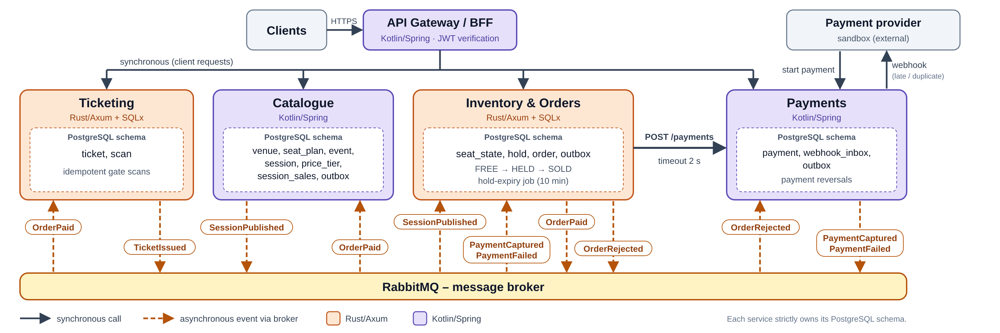

# WA2 Project – Milestone 1 (Group 6)

## 1. Team

Four members. Each stack has two developers so nobody works alone on it, and all members contribute across service design, API contracts, schemas, and testing.

| Member | Student ID |
| :--- | :--- |
| **Marinari** Alessandro Cesare Edoardo | 355035 |
| **Bosso** Lorenzo | 349410 |
| **Francioso** Federico | 349493 |
| **Mascarello** Daniele | 354165 |

## 2. Domain scope

Ticketing platform serving **organisers** (publish events, view sales), **customers** (hold & buy seats), and **gate staff** (validate tickets).

- **Catalogue:** Venues (sectors, rows, seats), events, sessions, price tiers, sales opening times.
- **Seat inventory:** Seats are FREE, HELD, or SOLD. Holds last 10 minutes and expire server-side without client requests.
- **Purchase:** Orders created from holds; paid via provider sandbox. Webhooks arrive late/duplicated/out-of-order.
- **Tickets:** 1 ticket per paid seat. Gate validation is idempotent (re-scanning never admits twice).
- **Organiser dashboard:** Session sales read models built strictly from events (no cross-database queries).
- **Optional requirements:** 1. Waiting room with admission control for release-day spikes; 2. Email notifications for ticket issuance; 3. Refunds: customers can cancel an unscanned ticket before the session starts, triggering a provider refund and releasing the seat (`SOLD` $\rightarrow$ `FREE`).

## 3. Proposed services & Stack assignment

4 services + 1 Gateway split along consistency boundaries. Each service strictly owns its PostgreSQL schema. To eliminate race conditions and double-booking, seat inventory and orders reside within the same service.

  

    

| Service | Stack | Responsibility | Owns (Schema) | Talks to |
| :--- | :--- | :--- | :--- | :--- |
| **API Gateway / BFF** | Kotlin/Spring | Single entry point, JWT verification, routing | *None* | All services (Sync) |
| **Catalogue** | Kotlin/Spring | Venues, plans, events, sessions, sales dashboard | `venue`, `seat_plan`, `event`, `session`, `price_tier`, `session_sales`, `outbox` | Publishes `SessionPublished` Consumes `OrderPaid` |
| **Inventory & Orders** | Rust/Axum + SQLx | Seat booking, 10-min holds, order creation, validation | `seat_state`, `hold`, `order`, `outbox` | Consumes `SessionPublished`, `PaymentCaptured`, `PaymentFailed` Calls Payments (Sync) Publishes `OrderPaid`, `OrderRejected` |
| **Payments** | Kotlin/Spring | Provider sandbox, webhooks, payment reversals, reconciliation | `payment`, `webhook_inbox`, `outbox` | Consumes `OrderRejected` Publishes `PaymentCaptured`, `PaymentFailed` |
| **Ticketing** | Rust/Axum + SQLx | Ticket issuance, idempotent gate scans | `ticket`, `scan` | Consumes `OrderPaid` Publishes `TicketIssued` |

**Communication and Consistency**

- **Synchronous:** `Inventory & Orders` $\rightarrow$ `Payments` (`POST /payments`, 2s timeout) to initiate payment. Gateway $\rightarrow$ services for client requests. *This is the only inter-service sync call.*
- **Asynchronous & Outbox:** Events routed via RabbitMQ with transactional outbox in each publishing service. Consumers have dedicated queues with at-least-once delivery and strict idempotency (de-duplication by Order/Event ID).
- **Hold Expiry:** Scheduled background job in `Inventory & Orders` releases expired holds (`HELD` $\rightarrow$ `FREE`).
- **Payment Outcomes & Compensations:**
  - *Failed/Declined:* Payments emits `PaymentFailed` $\rightarrow$ Inventory releases seats immediately (`HELD` $\rightarrow$ `FREE`).
  - *Captured Late:* If `PaymentCaptured` arrives after hold/order expiration, Inventory emits `OrderRejected` $\rightarrow$ Payments consumes it and executes a payment reversal compensation.